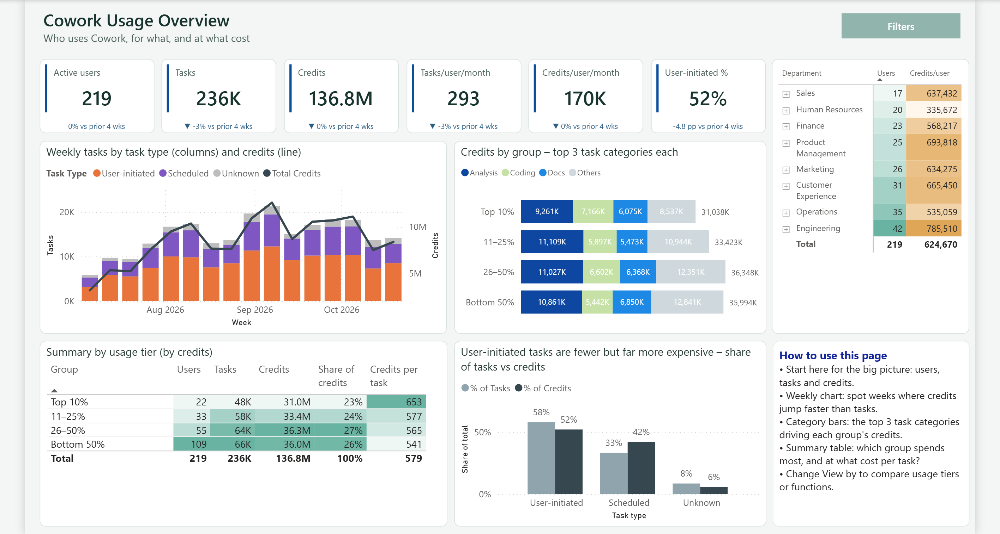

# Cowork Super Usage

A customer-ready Power BI report for exploring tier-focused Cowork super-user activity: concentration, trends, cohort and group behavior, share shift, and directional scenario value.

> **Demonstration only:** This repository contains synthetic data. Value estimates are scenario outputs—not forecasts or guaranteed realized savings.

## Walkthrough

https://github.com/user-attachments/assets/f9f3fb74-f162-45a1-ab34-1977b0557cbb

**[Open or download the 3:43 natural-voice walkthrough](media/CoworkSuperUsage-Walkthrough.mp4)**  

## Downloads

- [Power BI report (`CoworkSuperUsage.pbix`)](CoworkSuperUsage.pbix)
- [Power BI template (`CoworkSuperUsage.pbit`)](CoworkSuperUsage.pbit)
- [Interpretation guide (`CoworkSuperUsage-Interpretation-Guide.pptx`)](CoworkSuperUsage-Interpretation-Guide.pptx)
- [Walkthrough (`media/CoworkSuperUsage-Walkthrough.mp4`)](media/CoworkSuperUsage-Walkthrough.mp4)
- [Synthetic weekly metrics](sample-data/CoworkWeeklyMetrics.csv)
- [Synthetic people metadata](sample-data/PeopleMetaData.csv)
- [Release manifest](RELEASE-MANIFEST.md)

## Eight report pages

| Page | What it answers |
|---|---|
| Overview | What is the overall usage profile and where are the main signals? |
| Cost Concentration | How concentrated are credits and tasks among high-usage tiers? |
| Trends | How do usage, participation, and tier patterns change over time? |
| Group Breakdown | How do cohorts or organizational groups compare? |
| Value assumptions | What directional value results follow from adjustable scenario assumptions? |
| Appendix - Share Shift | How does activity share move among tiers over time? |
| Metric Glossary | How are the report's measures and terms defined? |
| Category assumptions | How are task categories interpreted and grouped? |

## Setup

1. Download the PBIX for the ready-to-use report, or the PBIT to create a fresh report instance.
2. Keep the two CSV files together in a folder:
   - `CoworkWeeklyMetrics.csv`: `PersonId`, `MetricDate`, `TaskCategory`, `TaskType`, `Total credits used`, `Total Cowork tasks`, `PeopleHistoricalId`
   - `PeopleMetaData.csv`: `PeopleHistoricalId`, `Organization`, `FunctionType`, `IsCopilotLicensed`
3. In Power BI Desktop, update the data-source folder/path if prompted.
4. Confirm the relationship uses `PeopleHistoricalId`, then refresh.
5. Review the interpretation guide before presenting findings.

## Privacy and interpretation

- All included records are synthetic demonstration data.
- Synthetic identifiers use `SYN-P####` and `SYN-H####`; the files contain no names or email addresses.
- Do not use this sample to infer facts about real people or organizations.
- Scenario value depends on user-selected assumptions and should support discussion and validation, not be represented as guaranteed savings.
- Before using organizational data, apply your privacy, security, retention, access-control, and responsible-use requirements.

## Troubleshooting

- **Refresh cannot find files:** update the Power Query source to the local `sample-data` folder.
- **Rows do not join:** preserve the exact headers and ensure every weekly row's `PeopleHistoricalId` exists in metadata.
- **Unexpected page results:** clear filters/slicers and confirm both CSVs were refreshed.
- **Video does not render inline:** use the prominent open/download link above; GitHub rendering varies by client.
- **Power BI version warning:** update Power BI Desktop and retry.

Public access requires no GitHub sign-in for browsing or downloading these files.

## Project policies

Contributions are welcome under [CONTRIBUTING.md](CONTRIBUTING.md). Report vulnerabilities privately as described in [SECURITY.md](SECURITY.md). Content is provided under the [MIT License](LICENSE).
